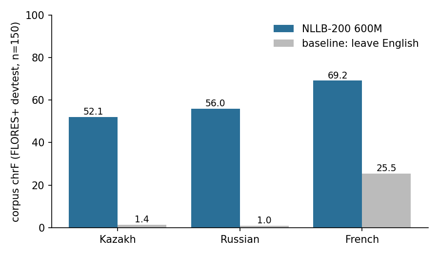
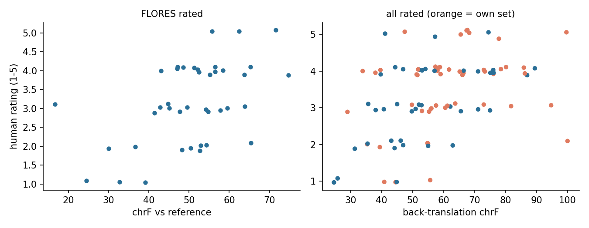
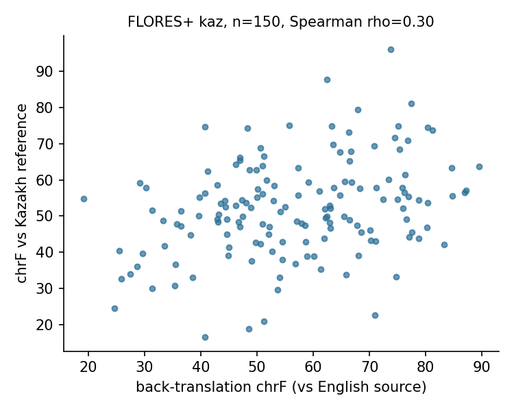
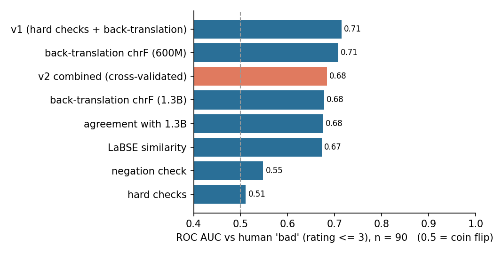

# Senim — full report

**Veritas AI International High School Hackathon 2026 · Track: AI + Languages · Brief 4.4.2 "Translation quality test"**

This is the long version with every result and caveat. The one-page write-up is in [README.md](README.md).

> **This project is a prototype and is not medical advice.**

English → Kazakh machine translation, plus a warning label that says when a translation should **not** be trusted, and why.

- Notebook (runs on a free Colab T4 GPU): [`notebook.ipynb`](notebook.ipynb) · [open in Colab](https://colab.research.google.com/github/arturbaimuratov1-sys/senim/blob/main/notebook.ipynb)
- Demo app: [`app.py`](app.py) (Gradio)
- Trust-check code: [`senim.py`](senim.py) · tests: [`tests/test_hard_checks.py`](tests/test_hard_checks.py)
- All result tables and charts: [`results/`](results). Full translations: [`results/flores_translations.csv`](results/flores_translations.csv), [`results/own_set_translations.csv`](results/own_set_translations.csv)
- Ratings side by side (human and LLM judge), easy to read in Excel: [`results/ratings_view.xlsx`](results/ratings_view.xlsx)

---

## The problem

A grandmother in Kazakhstan gets a medicine leaflet in English, or a parent gets a letter from an international school. They don't read English, so they paste the text into a free translator. The translation *looks* fluent. But if it turned "every 8 hours" into "every 6 hours", or "if you notice bleeding" into "if you do **not** have bleeding", they have no way to know.

Translators always give an answer and never say "I'm not sure". For Kazakh, a lower-resource language, mistakes are more common than for French or Russian. Our question: **can we warn the reader when a Kazakh translation is risky, using only free tools and no Kazakh reference translation?**

## What we built

1. **A translation quality test** (the brief): 150 sentences from the FLORES+ benchmark, translated by Meta's open NLLB-200 (600M) model into Kazakh, Russian and French, scored with chrF against professional human translations, and compared with a "do nothing" baseline (just show the English).
2. **Our own test set**: 50 English sentences of the kind our users actually meet: 25 from medicine leaflets, 25 from school letters, many with doses, times and dates.
3. **Senim's trust check**: for each translation, a label **"likely OK"** or **"do not rely on this"**, with the reasons in Kazakh and English.
4. **A demo app** where you paste English text and get the Kazakh translation, the trust label (with reasons in Kazakh), a back-translation to check against, and, when there is a warning, an improved translation (the best of 8 candidates, section 7).

## What we added (beyond the brief)

- **A safety check for the things that hurt most**: numbers, dosage units (mg, ml, °C…), clock times, months and weekdays must survive translation. Number words count too ("two" = "екі" = 2), and "6:00 PM" is allowed to become "18:00".
- **A no-reference quality signal**: translate the Kazakh back into English and compare it with the original (back-translation chrF). This works on any new text, where no human reference exists.
- **A negation check** (v2): the number of negations ("not", "never", "without"… vs Kazakh "емес", "жоқ", the verb suffix -ма/-ме) must match. It targets the most dangerous error we found: "if you notice bleeding" → "if you do **not** have bleeding".
- **Error reduction** (v3): instead of one translation, Senim generates 8 candidates (NLLB 600M and 1.3B) and keeps the one that passes the checks and back-translates best: +2.6 chrF on the held-out test set (section 7).
- **An honest evaluation of the trust check**: the warning threshold is tuned on one half of the rated translations and tested on the other half, against the baseline "always trust".

## How it works

```
English text ──► NLLB-200 ──► Kazakh text ──► NLLB-200 ──► back to English
                                   │                              │
                                   ▼                              ▼
                      hard checks vs. original          chrF(back-translation, original)
       (numbers, units, times, dates, negations)          below threshold 63.0?
                                   └────────────┬─────────────────┘
                                                ▼
                       any problem → ⚠️ "Do not rely on this translation" + reasons
                                       + an improved translation: best of 8 candidates (v3)
                       none        → ✅ "Likely OK"
```

- **chrF** compares character n-grams between a translation and a reference, on a 0–100 scale. We use sacreBLEU's implementation.
- **The threshold** (63.0) was chosen on the *calibration* half of the human-rated translations only, to maximise F1 for catching bad translations. The *test* half was never used to choose anything.
- **The hard-check rules** were revised once, after the first Colab run and before any rating existed. The fixes came from looking at flagged *translations* (not ratings), including some sentences that later ended up in the rated set (for example "6:00 PM" → "18:00" and the colloquial weekday "шейшембі"). So the hard-check results on those sentences are slightly optimistic. Other fixes: the first version wrongly treated "first aid" as the number 1 and missed that Kazakh "қыркүйек" (September) becomes "қыркүйегінде". The rules were frozen before rating.

## Results

All numbers come from the Colab run in `notebook.ipynb` (NLLB-200 distilled 600M, beam 4, T4 GPU; translating 150 sentences took 12–14 seconds per language).

### 1. Translation quality on FLORES+ (n = 150, corpus chrF)

| Language | NLLB-200 600M | Baseline: leave English |
|---|---|---|
| Kazakh | **52.1** | 1.4 |
| Russian | **56.0** | 1.0 |
| French | **69.2** | 25.5 |



Kazakh scores lowest of the three: the model is clearly weaker on Kazakh than on French. Translating is still far better than showing English (chrF 1.4), but 52 is not "safe to trust blindly".

**The 5 worst Kazakh sentences** ([`results/worst5_kaz.csv`](results/worst5_kaz.csv), sentence chrF 16.7–24.5) show typical failure types:
- iPods became "iPhone" (Айфон);
- a 21–20 rugby result ending a winning streak came out as the team "won 15 games";
- in one case the whole second sentence was dropped.

### 2. Human ratings of 90 translations

We rated 90 Kazakh translations (all 50 of ours and 40 random FLORES ones) on a 1–5 scale:
- 5 = correct;
- 3 = meaning partly wrong or something missing;
- 1 = useless or dangerous.

**Who rated.** The project author rated all 90 in Excel and, for every translation, wrote what is wrong and how it should read (`data/ratings_human_filled.xlsx`, also merged into `data/ratings.csv`). The author says they did this without looking at the AI's numbers. Separately and earlier, Claude Opus 5.5 rated the same 90 as an LLM judge; those scores are kept in the `llm_*` columns for comparison. There is only one human rater, so we cannot measure agreement between people.

| | n | mean (human) | bad (≤ 3) | serious (≤ 2) |
|---|---|---|---|---|
| Our medicine sentences | 25 | 3.40 | 13 | 5 |
| Our school sentences | 25 | 3.60 | 8 | 3 |
| FLORES | 40 | 3.15 | 23 | 11 |
| **All** | **90** | **3.34** | **44** | **19** |

**Medicine leaflets came out worse than school letters**: 13 of 25 bad, against 8 of 25. This is bad news for the people we care about most.

What went wrong in the 44 bad translations (from the author's comments):

| Problem | Count | Example |
|---|---|---|
| meaning distorted | 19 | "consult a doctor" → "give advice to the doctor"; developed countries → "developing" |
| wrong or unnatural word | 12 | red cabbage → "red vegetable"; exam → "class" |
| content dropped | 8 | the translation stops halfway: "do not take with alcohol because it…" |
| grammar or logic | 3 | "so that" → "therefore" |
| wrong date | 1 | Friday → Sunday |
| name or term | 1 | |

Two of the "meaning distorted" cases are **flipped negations**, the most dangerous kind:
- "if you notice unusual bleeding" → "if you do **not** have usual bleeding";
- "your child may miss the trip" → "may **not** miss the trip".

### 3. Human vs. LLM judge

| | |
|---|---|
| Same score | 47 / 90 |
| Within 1 point | 89 / 90 |
| Spearman ρ | 0.87 |
| Quadratic-weighted κ | 0.80 |
| Agree on "bad (≤ 3)" | 76 / 90 (κ = 0.69) |
| Agree on "serious (≤ 2)" | 86 / 90 (κ = 0.86) |
| Mean score: human / LLM | 3.34 / 3.81 |

The two raters order the translations very similarly, but **the human is stricter**: lower in 42 cases, higher in 1. The LLM judge called 32 translations bad, the human 44. All but one of the LLM's "bad" were also bad for the human. In short, an LLM judge is a usable first filter, but it is too lenient to replace a human. Full confusion table: [`results/human_vs_llm_confusion.csv`](results/human_vs_llm_confusion.csv).

### 4. Does chrF agree with human ratings? (Spearman correlation)

| Signal | Subset | n | Spearman ρ | p |
|---|---|---|---|---|
| chrF vs Kazakh reference | FLORES rated | 40 | 0.48 | 0.002 |
| back-translation chrF (no reference needed) | all rated | 90 | 0.43 | < 0.001 |
| back-translation chrF | our set | 50 | 0.35 | 0.012 |
| back-translation chrF | FLORES rated | 40 | 0.51 | < 0.001 |



Both are moderate signals, far from perfect, and back-translation is weakest on our own medicine and school sentences (0.35). In the right-hand plot, one of our sentences got a perfect back-translation score of 100 but a human rating of 2: the back-translation "repaired" the error, so the check could not see it. It is `own_19`: "consult a doctor" became "give advice to the doctor", and translating back gave exactly the original English. On all 150 FLORES sentences, back-translation chrF and reference chrF agree only weakly: ρ = 0.30 (p = 0.0002).



### 5. Does the trust check catch bad translations? (human labels, test half only, n = 45)

The threshold was chosen on the other 45 sentences.

**"Bad" = rating ≤ 3** (25 of the 45 test sentences are bad):

| System | Bad caught | False alarms (of 20 good) | Precision |
|---|---|---|---|
| Always trust (baseline) | 0 / 25 | 0 | – |
| Always warn (for comparison) | 25 / 25 | 20 (100%) | 56% |
| Hard checks only | 1 / 25 | 0 | 100% |
| **Senim (threshold 63.0)** | **19 / 25 (76%)** | 13 (65%) | 59% |

**"Bad" = rating ≤ 2, serious errors only** (8 of 45):

| System | Bad caught | False alarms (of 37 good) | Precision |
|---|---|---|---|
| Always trust (baseline) | 0 / 8 | 0 | – |
| Hard checks only | 1 / 8 | 0 | 100% |
| **Senim (threshold 47.0)** | **6 / 8 (75%)** | 9 (24%) | 40% |

**How to read this honestly:**
- **Serious errors: the check helps.** It catches 6 of 8 while warning on only 24% of acceptable translations. When it warns, the translation is seriously wrong 40% of the time, against 18% (8 of 45) if you picked at random.
- **The broad "≤ 3" definition: the check barely beats warning on everything.** By the human's strict standard more than half of the translations are bad, so a warning is right only 59% of the time, against 56% for "always warn". It catches 76%, but also flags 65% of good translations.
- **The numbers are uncertain.** With 45 test sentences, the 95% Wilson interval for "6 of 8 caught" is 41–93%.
- **Compared with the LLM labels:** with the LLM judge's ratings, the same procedure caught 12 / 16 bad (≤ 3) with 38% false alarms, but only 1 / 7 serious ones ([`results/trust_check_eval_llm.csv`](results/trust_check_eval_llm.csv)). Who rates changes the conclusion, which is one more reason human labels matter.

**Weak spots, shown as they are:**
- **Hard checks catch little.** NLLB kept numbers, times and dates right almost every time: hard checks flagged 1 of our 50 sentences, the Friday → Sunday error. The real damage was distorted meaning and wrong words, which only back-translation sometimes notices.
- **Back-translation can hide errors.** When NLLB makes a mistake, translating back with the same model often "repairs" it.
- **One human rater** who is the project author, not an independent professional, and who saw the translations while building the project. The procedure was first run with the LLM labels and then repeated unchanged with the human labels.
- **Small data.** 90 rated sentences, 45 in the test half.

### 6. Senim v2: trying to make it smarter

We tried four new signals, aimed at what v1 missed:

| Signal | Idea |
|---|---|
| negation check | the number of negations must match |
| back-translation by NLLB 1.3B | a *different*, bigger model translates back, so it is less likely to "repair" the error |
| agreement with NLLB 1.3B | if two models translate differently, be careful |
| LaBSE similarity | a multilingual sentence-embedding model compares the meaning of the English and the Kazakh directly |

We also combined all six signals in a logistic regression. The procedure was fixed in advance: same split, fit and threshold on the calibration half, and cross-validation over all 90 (5 folds × 20 repeats), so that the result does not depend on one lucky split.

**A bigger model translates better** (FLORES+, n = 150, corpus chrF; [`results/v2_chrf_600m_vs_1p3b.csv`](results/v2_chrf_600m_vs_1p3b.csv)):

| Language | NLLB 600M | NLLB 1.3B |
|---|---|---|
| Kazakh | 52.1 | **53.9** |
| Russian | 56.0 | **58.9** |
| French | 69.2 | **72.7** |

**How well each signal ranks bad translations above good ones** (ROC AUC on all 90 human-rated translations; 0.5 = coin flip, 1.0 = perfect):

| Signal | AUC, bad = ≤ 3 | AUC, serious = ≤ 2 |
|---|---|---|
| **v1 (hard checks + back-translation)** | **0.715** | **0.80** |
| back-translation chrF (600M) | 0.71 | 0.78 |
| back-translation chrF (1.3B) | 0.68 | 0.78 |
| agreement with 1.3B | 0.68 | 0.65 |
| LaBSE similarity | 0.67 | 0.67 |
| negation check | 0.55 | 0.55 |
| hard checks | 0.51 | 0.53 |
| **v2 combined model** (cross-validated) | 0.68 ± 0.11 | 0.73 ± 0.14 |



**The honest result: the "smarter" combined model is *not* better than the simple v1.** In cross-validation it beat v1 in only 41% of folds for "bad" and 19% for "serious". Each new signal on its own ranks translations worse than the plain back-translation score, and with only 90 rated sentences, six signals are too many to learn reliably. So the app does **not** use the combined model ([`results/v2_cv_auc.csv`](results/v2_cv_auc.csv), [`results/v2_trust_check_eval.csv`](results/v2_trust_check_eval.csv)).

**What we kept:**

1. **The negation check, as a separate warning.** It is noisy:
   - it fires on 19 of 150 *professional* FLORES translations, because Kazakh often says "could not finish" where English says "failed";
   - on the rated set it fired 16 times, and 10 of those were bad by the human's rating (5 serious).

   But it targets the error type that hurts most, and it tells the reader *what* is wrong, which a low back-translation score cannot. In `own_22` (bleeding), back-translation already looked bad ("If you do not bleed normally", chrF 40.9), but the warning now says why: a negation appeared that is not in the original. On the test half, adding it to v1 caught **7 of 8 serious errors instead of 6**, at the cost of more false alarms (38% instead of 24% of acceptable translations). For a medicine leaflet we prefer one more catch, so the app uses v1 + negation. This choice was made after seeing the test-half numbers, so treat the "7 of 8" as optimistic.

2. **The bigger model as a second opinion.** When Senim warns, the app showed the NLLB 1.3B translation. v3 (section 7) replaced this with the best of 8 candidates, which scores higher still.

### 7. Senim v3: reducing errors instead of only flagging them

The brief suggests: "find one type of error … and test a way to reduce it". We targeted the errors our checks look for (numbers, dates, negation) and tried four ways to produce a better translation. The plan and the decision rule were written before running: [`experiments/P3_PLAN.md`](experiments/P3_PLAN.md). Code: [`experiments/p3_reduce_errors.py`](experiments/p3_reduce_errors.py). Run on Kaggle (2 × T4 GPU, one used).

| System | Idea |
|---|---|
| A | NLLB 600M, beam 4 (the translator the human rated) |
| S | A, but sentence by sentence (against dropped sentences) |
| B | NLLB 1.3B, beam 4 |
| R600 | best of the 4 best 600M beams |
| **R** | **best of 8 candidates: 4 from 600M + 4 from 1.3B** |

"Best" means: drop candidates that fail the number/date/time or negation check, then keep the one whose back-translation is closest to the English source (chrF).

**Development set: FLORES+ dev, n = 997, never used before** ([`results/v3_dev_summary.csv`](results/v3_dev_summary.csv)):

| System | chrF | Gain over A (95% CI)* | Check failures (numbers/dates) | Negation flags | chrF vs author's corrections (90 rated) | Seconds / sentence (T4) |
|---|---|---|---|---|---|---|
| A | 50.37 | — | 72 | 174 | 57.45 | 0.12 |
| S | 51.40 | +0.94 (0.65 to 1.23) | 67 | 177 | 57.91 | 0.07 |
| B | 52.29 | +1.80 (1.09 to 2.43) | 75 | 192 | 59.65 | 0.18 |
| R600 | 50.96 | +0.52 (0.21 to 0.83) | 61 | 154 | 57.71 | 0.34 |
| **R** | **52.75** | **+2.15 (1.65 to 2.64)** | **47** | **127** | **59.68** | 0.52 |

\* Paired bootstrap (1000 resamples) of the mean sentence-level chrF gain.

The pre-registered rule demanded a gain whose 95% interval is above 0 **and** no increase in check failures or negation flags. S and B gain chrF but raise the negation flags (177 and 192 vs 174), so they do not qualify. R600 and R qualify; **R wins** with the largest gain. 43% of R's choices come from the 1.3B model, 76% differ from A's default output.

**Final test, run once: the 150 FLORES+ devtest sentences of the notebook** ([`results/v3_devtest_summary.csv`](results/v3_devtest_summary.csv)):

| System | chrF | Gain over A (95% CI) | Check failures | Negation flags | Seconds / sentence |
|---|---|---|---|---|---|
| A | 52.11 | — | 6 | 19 | 0.17 |
| **R** | **54.83** | **+2.56 (1.19 to 3.99)** | **2** | **13** | 0.75 |

A reproduces the notebook's 52.1 exactly, so the two setups agree.

**Read with care:**
- **The drop in check failures is partly built in.** R *chooses* candidates that pass these checks, so fewer failures is expected. The independent evidence is chrF against professional references (+2.15 dev, +2.56 test) and against the author's corrected translations. The corrections were made by editing A's output, which favours A, and R still scores higher there (57.5 → 59.7).
- **The checks are noisy on their own.** On the professional references they flag 64 number/date cases and 196 negation cases out of 997, so neither count is a pure error count.
- **R is about 4.4× slower** (0.75 vs 0.17 s per sentence on a T4) and needs both models in memory.
- **R's output was not rated by a human.** The trust threshold was calibrated on A's output, so the app keeps A as the checked translation and shows R as an "improved translation" only when it warns, and only on a GPU.
- Small run-to-run differences exist: A's score against the corrections was 57.45 in one run and 57.54 in another. Batching changes the padding, which changes a few beam-search outputs.

## What we'd do next

1. **More human raters**: 2–3 more fluent Kazakh speakers rate the same 90 translations (blank sheet: `data/ratings_human.xlsx`), so we can measure agreement between people, not just between one person and an LLM.
2. **A better negation check**: our regex version fires on 13% of professional translations. A Kazakh morphological analyser (for example Apertium-kaz) could tell real negation from words like "алмады" ("could not").
3. **More labelled data before adding signals**: v2 showed that with 90 ratings, extra signals mostly add noise. Around 300–500 rated sentences would let a combined model, or a learned quality-estimation model such as COMET-Kiwi, pay off.
4. **Switch the main translator to NLLB 1.3B or 3.3B** (+1.8 chrF on Kazakh) and re-rate its output, so that the trust check is calibrated for the better model.
5. **A "Russian loanword" detector**, since the author noticed Russian words in the output.
6. **Test with real users**: is a warning useful, or does a high false-alarm rate teach people to ignore it?
7. **Use the author's corrections**: every bad translation now has a human-written correct version (`human_correction`), which can serve as a small Kazakh reference set for medicine and school texts.

## Run it yourself

- **Notebook:** open it [in Colab](https://colab.research.google.com/github/arturbaimuratov1-sys/senim/blob/main/notebook.ipynb) and choose Runtime → Change runtime type → **T4 GPU**. Add your Hugging Face token as the Colab secret `HF_TOKEN`; FLORES+ is gated, so accept its terms on Hugging Face first. Then Runtime → Run all.
- **App:** `pip install -r requirements.txt && python app.py`, or `!python app.py` in Colab for a public link.
- **Tests:** `pip install pytest && python -m pytest tests/`

## Sources

Full list with links and licences: [SOURCES.md](SOURCES.md).

- **Data:** FLORES+ (Open Language Data Initiative, CC BY-SA 4.0); own test set written by the author.
- **Models:** NLLB-200 distilled 600M and 1.3B (Meta, CC BY-NC 4.0); LaBSE (Google, Apache 2.0) via sentence-transformers.
- **Metric:** chrF (Popović 2015) via sacreBLEU.
- **Libraries:** PyTorch, Transformers, Datasets, sentence-transformers, scikit-learn, Gradio, pandas, SciPy, Matplotlib. Platform: Google Colab.
- **Ratings:** the author (human, primary); Claude Opus 5.5 as an LLM judge (secondary, for comparison).
- **AI tools:** Claude Code (Claude Opus 5.5) wrote most of the code, ran the notebook in Colab, gave the LLM-judge ratings, and drafted this write-up.

*This project is a prototype and is not medical advice.*
